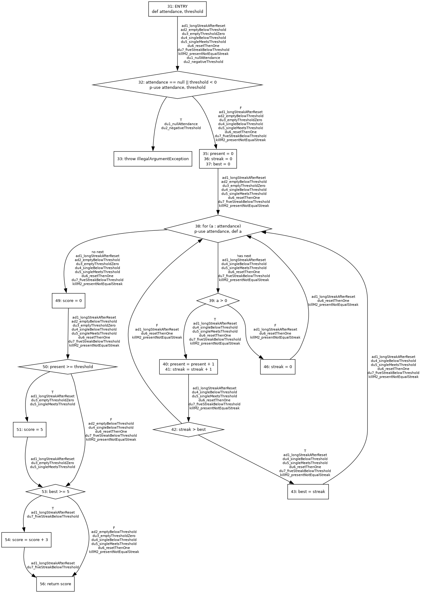

# Lab 10: Data flow testing (DU анализ)

Нэр: А.Адъяахүү
Оюутны код: B232270125

## Орчин

```
$ java -version
openjdk version "17.0.21.0.3" 2026-10-24
OpenJDK Runtime Environment (build 17.0.21.0.3+1-1-26.04.1-Ubuntu)
OpenJDK 64-Bit Server VM (build 17.0.21.0.3+1-1-26.04.1-Ubuntu, mixed mode, sharing)

$ mvn -version
Apache Maven 3.9.12
Maven home: /usr/share/maven
Java version: 17.0.21.0.3, vendor: Ubuntu, runtime: /usr/lib/jvm/java-17-openjdk-amd64
Default locale: en, platform encoding: UTF-8
OS name: "linux", version: "6.18.54.1-microsoft-standard-wsl2", arch: "amd64", family: "unix"
```

Ubuntu (WSL2) дээр ажилласан.

## Тестийн ID → метод

| ID | Метод |
|---|---|
| G1 | GcdTest.g1_noLoop (gcd(7,0)) |
| G2 | GcdTest.g2_twoIterations (gcd(12,8)) |
| AD1 | BonusTest.ad1_longStreakAfterReset |
| AD2 | BonusTest.ad2_emptyBelowThreshold |
| DU1 | BonusTest.du1_nullAttendance |
| DU2 | BonusTest.du2_negativeThreshold |
| DU3 | BonusTest.du3_emptyThresholdZero |
| DU4 | BonusTest.du4_singleBelowThreshold |
| DU5 | BonusTest.du5_singleMeetsThreshold |
| DU6 | BonusTest.du6_resetThenOne |
| DU7 | BonusTest.du7_fiveStreakBelowThreshold |
| KILL_M2 | BonusTest.killM2_presentNotEqualStreak |

## A. gcd: DU хүснэгт

Def: 13 (параметр x, y), 16 (tmp), 17 (x), 18 (y). 14-р мөрийн `int tmp;` нь зарлал бөгөөд def биш.

| Хувьсагч | Def | Use | c/p | Def-clear зам | Тест | Хамрагдсан |
|---|---|---|---|---|---|---|
| x | 13 | 16 | c | 13→15→16 | G2 | тийм |
| x | 13 | 20 | c | 13→15→20 | G1 | тийм |
| x | 17 | 16 | c | 17→18→15→16 | G2 | тийм |
| x | 17 | 20 | c | 17→18→15→20 | G2 | тийм |
| y | 13 | 15 (T) | p | 13→15 | G2 | тийм |
| y | 13 | 15 (F) | p | 13→15 | G1 | тийм |
| y | 13 | 16 | c | 13→15→16 | G2 | тийм |
| y | 13 | 17 | c | 13→15→16→17 | G2 | тийм |
| y | 18 | 15 (T) | p | 18→15 | G2 | тийм |
| y | 18 | 15 (F) | p | 18→15 | G2 | тийм |
| y | 18 | 16 | c | 18→15→16 | G2 | тийм |
| y | 18 | 17 | c | 18→15→16→17 | G2 | тийм |
| tmp | 16 | 18 | c | 16→17→18 | G2 | тийм |

Нийт 13 хос, бүгд хамрагдсан. G1 = gcd(7,0), G2 = gcd(12,8).

Лекцийн хүснэгтэд дутуу байсан хос: y: 13→17 (слайдад (1,5)), y: 18→16 (слайдад (6,4)), y: 18→17 (слайдад (6,5)). Слайд нь p-use-ийн T/F салааг нэг хос гэж тоодог, би тусад нь тоосон.

**gcd(7,0) ганцаараа юу хамардаг вэ?** Давталтад орохгүй тул зөвхөн x: 13→20 ба y: 13→15(F) хосыг хамарна. Өөр тест эдгээрийг хамардаггүй.

**gcd(12,8) хэдэн давталт хийх вэ?** 2 давталт: (12,8)→(8,4)→(4,0). Давталт шаардах хос:
- 1 давталт хангалттай (7 хос): x:13→16, x:17→20, y:13→15(T), y:13→16, y:13→17, y:18→15(F), tmp:16→18
- 2 давталт шаардана (4 хос): x:17→16, y:18→15(T), y:18→16, y:18→17. Эдгээрийн def нь эхний давталтад, use нь дараагийн давталтад байдаг.

## B. bonus: анализ

### B1. CFG


Graphviz-ээр зурсан (`cfg-bonus.dot`). 35–37 ба 40–41 нь шулуун дараалал тул нэг зангилаанд нэгтгэж, зангилаан дотор мөр бүрийг тусад нь бичсэн. For-each (мөр 38)-ийн нөхцөл нь attendance-д дараагийн элемент байгаа эсэх (attendance-ийн p-use), алхам нь a-д оноолт (a-ийн def). Ирмэг бүрийн хажууд түүнийг дайрдаг BonusTest-ийн метод нэрийг бичсэн.

### B2. Def/Use жагсаалт

| Мөр | Def | c-use | p-use |
|---|---|---|---|
| 31 | attendance, threshold | | |
| 32 | | | attendance, threshold |
| 35 | present | | |
| 36 | streak | | |
| 37 | best | | |
| 38 | a | | attendance (дараагийн элемент байна уу) |
| 39 | | | a |
| 40 | present | present | |
| 41 | streak | streak | |
| 42 | | | streak, best |
| 43 | best | streak | |
| 46 | streak | | |
| 49 | score | | |
| 50 | | | present, threshold |
| 51 | score | | |
| 53 | | | best |
| 54 | score | score | |
| 56 | | score | |

### B3. DU хүснэгт (kill тэмдэглэгээтэй)

| Хувьсагч | Def | Use | c/p | Def-clear зам | Тест | Хамрагдсан |
|---|---|---|---|---|---|---|
| attendance | 31 | 32 (T) | p | 31→32 | DU1 | тийм |
| attendance | 31 | 32 (F) | p | 31→32 | AD1 | тийм |
| attendance | 31 | 38 (T) | p | 31→32→35…37→38 | AD1 | тийм |
| attendance | 31 | 38 (F) | p | 31→32→35…37→38 | AD2 | тийм |
| threshold | 31 | 32 (T) | p | 31→32 | DU2 | тийм |
| threshold | 31 | 32 (F) | p | 31→32 | AD1 | тийм |
| threshold | 31 | 50 (T) | p | 31→32→35…37→38→49→50 | DU3 | тийм |
| threshold | 31 | 50 (F) | p | 31→32→35…37→38→49→50 | AD2 | тийм |
| present | 35 | 40 | c | 35→36→37→38→39→40 | AD1 | тийм |
| present | 35 | 50 (T) | p | 35→36→37→38→49→50 | DU3 | тийм |
| present | 35 | 50 (F) | p | 35→36→37→38→49→50 | AD2 | тийм |
| present | 40 | 40 | c | 40→41→42→(43)→38→39→40 | AD1 | тийм |
| present | 40 | 50 (T) | p | 40→41→42→38→49→50 | AD1 | тийм |
| present | 40 | 50 (F) | p | 40→41→42→38→49→50 | DU4 | тийм |
| streak | 36 | 41 | c | 36→37→38→39→40→41 | AD1 | тийм |
| streak | 41 | 41 | c | 41→42→(43)→38→39→40→41 | AD1 | тийм |
| streak | 41 | 42 (T) | p | 41→42 | DU4 | тийм |
| streak | 41 | 42 (F) | p | 41→42 | AD1  | тийм |
| streak | 41 | 43 | c | 41→42→43 | DU4 | тийм |
| streak | 46 | 41 | c | 46→38→39→40→41 | AD1  | тийм |
| best | 37 | 42 (T) | p | 37→38→39→40→41→42 | DU4 | тийм |
| best | 37 | 42 (F) | p | — | — | биелэшгүй |
| best | 37 | 53 (T) | p | — | — | биелэшгүй |
| best | 37 | 53 (F) | p | 37→38→49→50→53 | AD2 | тийм |
| best | 43 | 42 (T) | p | 43→38→39→40→41→42 | AD1 | тийм |
| best | 43 | 42 (F) | p | 43→38→39→40→41→42 | AD1  | тийм |
| best | 43 | 53 (T) | p | 43→38→49→50→53 | DU7 | тийм |
| best | 43 | 53 (F) | p | 43→38→49→50→53 | DU4 | тийм |
| a | 38 | 39 (T) | p | 38→39 | AD1 | тийм |
| a | 38 | 39 (F) | p | 38→39 | AD1 | тийм |
| score | 49 | 54 | c | 49→50→53→54 | DU7 | тийм |
| score | 49 | 56 | c | 49→50→53→56 | AD2 | тийм |
| score | 51 | 54 | c | 51→53→54 | AD1 | тийм |
| score | 51 | 56 | c | 51→53→56 | DU3 | тийм |
| score | 54 | 56 | c | 54→56 | AD1 | тийм |

Нийт 35 хос, үүнээс 2 нь биелэшгүй. Биелэх 33 хос бүгд хамрагдсан.

**Биелэшгүй хосууд:**
- best 37→42 (F): 37-ийн def-ээс 42 хүртэл def-clear байхын тулд 43 хараахан ажиллаагүй байх ёстой. Тэгвэл 42-д анх хүрэхэд streak = 1 > best = 0 үргэлж үнэн, тэгэхээр F салаа боломжгүй.
- best 37→53 (T): 43 ажиллаагүй бол best = 0, тэгэхээр 0 >= 5 худал, T салаа боломжгүй.

**Kill (мөр 46):** else салаа дахь `streak = 0` нь streak-ийн def 36 ба 41-ийг kill хийнэ. 36→39→46→…→41 болон 41→…→46→…→41 замууд def-clear биш. Гэхдээ a>0 салаагаар def-clear зам байгаа тул 36→41, 41→41 хос хэвээр үлдэнэ. Дараах хослолууд DU хос биш, учир нь замдаа мөр 41-д streak дахин тодорхойлогдож kill болдог: 36→42, 36→43, 46→42, 46→43. Мөн 46-ын def зөвхөн 41-д хүрнэ.

**Бусад kill:** score def 51 нь 49-ийг, def 54 нь 49 ба 51-ийг kill хийнэ. present def 40 нь 35-ыг kill хийнэ. best def 43 нь 37-г kill хийнэ.

### B4. All-defs ба all-DU-pairs

**All-defs: 2 тест (AD1, AD2).** score-ийн def 49 нь зөвхөн 50 нь F үед use-д хүрнэ, учир нь T үед 51 дахин оноодог. Харин def 51 нь зөвхөн 50 нь T үед ажиллана. Иймээс нэг гүйцэтгэлд 49 ба 51 хоёулаа use-д хүрч чадахгүй, 1 тест хүрэлцэхгүй. AD1 (`{1,1,0,1,1,1,1,1}`, threshold 3) нь 51 ба 54-ийг, AD2 (`{}`, threshold 1) нь 49-ийг use-д хүргэнэ. Бусад бүх def AD1-ээр use-д хүрнэ.

**All-DU-pairs: 7 тест нэмсэн (DU1–DU7).** AD1+AD2-ээр хамрагдаагүй байсан хос:
- DU1: attendance 31→32 (T)
- DU2: threshold 31→32 (T)
- DU3: present 35→50 (T), score 51→56
- DU4: present 40→50 (F), best 43→53 (F)
- DU7: score 49→54

DU5, DU6 нь шинэ хос нэмээгүй (AD1 аль хэдийн хамарсан). Тэдгээрийг хилийн утга (present == threshold, дараа нь дахин тасалдал) шалгах зорилгоор үлдээсэн. M2-ийг унагах тест (KILL_M2) нь DU хос биш, мутацийн үр дүнд нэмэгдсэн.

BonusTest: all-defs шатанд 2, all-DU-pairs шатанд 7 тест нэмж нийт 9. Дараа нь M2-ийг унагах 1 тест нэмж 10 болсон.

### B5. JaCoCo

| Шат | Файл | Tests run | Branch missed/covered | Line missed/covered |
|---|---|---|---|---|
| all-defs | results/jacoco-alldefs.csv | 4 (GcdTest 2 + BonusTest 2) | 2 / 14 | 2 / 22 |
| эцсийн | results/jacoco-final.csv | 12 (GcdTest 2 + BonusTest 10) | 0 / 16 | 1 / 23 |

All-defs шатанд Branch 14/16 (87.5%) байсан, иймээс all-defs хангагдсан ч branch 100% биш байж болно. Дутсан 2 салаа нь мөр 32-ын `attendance == null` ба `threshold < 0` нөхцлийн T салаа: AD1, AD2 хэзээ ч exception шидэхгүй. Үүнтэй нийцүүлэн Line missed = 2 нь 7-р мөр (далд constructor) ба 33-р мөр (throw). Эцсийн 12 тестээр Branch 16/16 болсон. LINE_MISSED = 1 нь 7-р мөрийн далд constructor бөгөөд хэвийн.

**Branch 100% байхад DU хос үлдэх жишээ.** Онолын хувьд AD1, AD2, DU1, DU2 дөрвөөр branch 16/16 болох боловч score 49→54 (50 нь F, 53 нь T хэрэгтэй), score 51→56, present 35→50 (T) зэрэг хос хамрагдахгүй. Өөр нэг жишээ нь M2: branch 16/16 ба бүх DU хос хамрагдсан байхад `best = present` мутаци амьд үлдсэн.

## C. Fault seeding

M1, M2 нь M2-ийг унагах тест нэмэхээс өмнө (11 тест), M2-kill, M3 нь нэмсний дараа (12 тест) ажилласан.

| Мутаци | Төрөл | Tests run | Үр дүн | Унасан тест, expected/was | Файл |
|---|---|---|---|---|---|
| M1: `streak = streak + 1` устгах | Missing update | 11 | Баригдсан | BonusTest.ad1_longStreakAfterReset: expected <8> but was <5>; BonusTest.du7_fiveStreakBelowThreshold: expected <3> but was <0> | results/mvn-test-M1.txt |
| M2: `best = present` | Wrong variable | 11 | АМЬД, BUILD SUCCESS | үгүй | results/mvn-test-M2.txt |
| M2 + нэмэлт тест | Wrong variable | 12 | Баригдсан | BonusTest.killM2_presentNotEqualStreak: expected <0> but was <3> | results/mvn-test-M2-kill.txt |
| M3: `int total = present + best;` | Dead definition | 12 | АМЬД, BUILD SUCCESS | үгүй | results/mvn-test-M3.txt |

### M1
streak үргэлж 0 болж best хэзээ ч өсөхгүй, тиймээс `best >= 5` салаа (урт цувааны бонус +3) алга болсон. Зөвхөн энэ салааг шалгадаг хоёр тест унасан.

### M2: яагаад амьд үлдсэн бэ
Миний all-DU-pairs тестүүдэд best шинэчлэгдэх мөчид present ба streak ижил утгатай байсан (цуваа тасраагүй, эсвэл тасарсан ч шийдвэр өөрчлөгдөөгүй). DU хамралт нь def-ээс use хүртэл утга дамжсан эсэхийг шалгадаг, дамжсан утга зөв эсэхийг шалгадаггүй: `best = present` ба `best = streak` хоёр нь ижил def-use хосыг үүсгэнэ. Унагасан тест: `{1,0,1,1,1,1}`, threshold=6. Нийт ирц 5 боловч хамгийн урт цуваа 4. Эх код: best=4 (<5), present=5 (<6) тул 0 өгнө. M2-д сүүлийн 1 дээр present=5, streak=4 > best=3 тул best = 5 болж, +3 бонус өгч 3 буцаана. Тест `expected <0> but was <3>`-оор унана.

### M3: яагаад ямар ч тест унаагаагүй вэ
`total` хэзээ ч хэрэглэгдэхгүй тул return утгад нөлөөлөхгүй. Тест зөвхөн гаралтыг шалгадаг учраас үхсэн def-ийг мэдрэхгүй. javac ч анхааруулдаггүй. Үүнийг static analysis (IDE inspection, SpotBugs, PMD) барих ёстой.

IDE анхааруулга (VS Code, Java extension, `DataFlowTargets.bonus` дотор `total` дээр):

```
The value of the local variable total is not used Java(536870973)
int total - mn.edu.must.sqat.DataFlowTargets.bonus(int[], int)
Source: jdt.ls-java-project
```

Энэ нь static analysis үхсэн def-ийг (M3) барьдгийг харуулж байна: тест унадаггүй, харин IDE анхааруулдаг.

## Дүгнэлт
DU анализ нь branch хамралтаас илүү нарийн: branch 16/16 болсон ч score 49→54, present 35→50 (T) зэрэг def-use хос хамрагдаагүй үлдэж болохыг all-defs шатанд харсан. Мөн def бүр хаана хэрэглэгдэж байгааг ойлгуулдаг учраас M1 төрлийн дутуу update-ийг цэгцтэй барихад тусална. Харин үнэтэй тал нь гараар def/use жагсаах, CFG зурах, def-clear зам олох, биелэшгүй хосыг үндэслэх ажил бөгөөд bonus шиг 35 хостой функцэд олон цаг орсон. Нөгөө талаар DU хамралт ч бүрэн хамгаалалт биш: M2 нь бүх хос хамрагдсан атал амьд үлдсэн, учир нь хос дээр дамжсан утга зөв эсэхийг шалгадаггүй. M3 (үхсэн def) ямар ч тестээр баригдахгүй, харин static analysis-аар баригдана. Иймээс DU хамралт, mutation testing, static analysis гурвыг хослуулах нь зүйтэй. Надад хамгийн их цаг авсан алхам нь B3-ийн DU хүснэгт: def-clear зам олох, kill шалгах.

## AI ашигласан байдал
Claude (Anthropic) ашигласан: тест төлөвлөх, mvn/git командын дараалал, мутаци хийх sed командууд, DU хүснэгтийн ноорог, Graphviz dot файл, README-ийн бүтэц. Хүснэгтийн мөр, тестийн нэр, тоо бүрийг кодтой болон results/ доторх файлтай тулган шалгасан.
